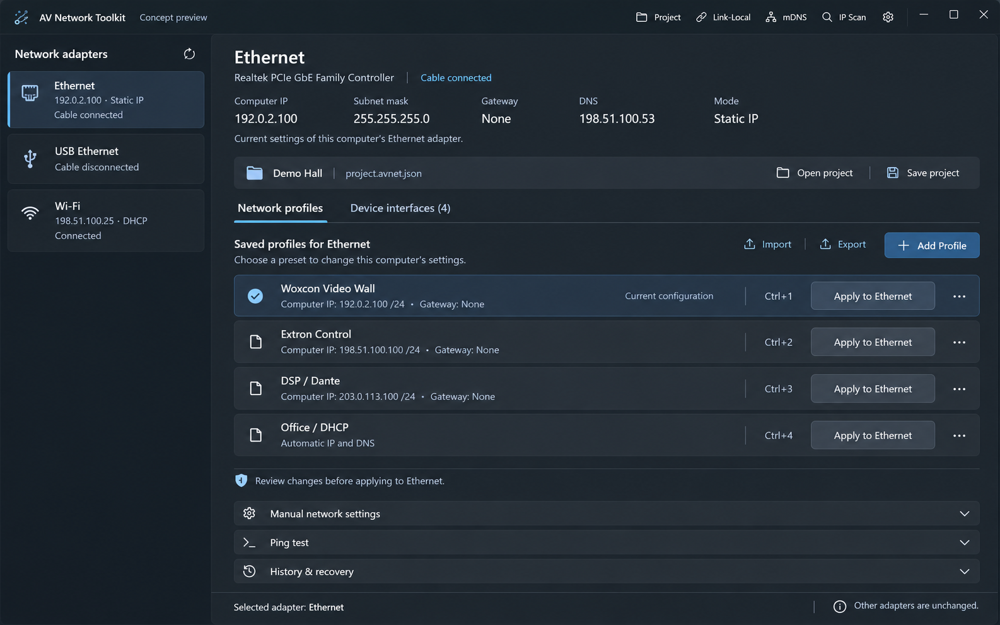

# Existing interface contract

Owner instruction, 2026-10-31: **all new buttons, windows and other interface elements must use the existing product's style and design**. This records the current design language; it does not authorize a redesign.

## Source of truth

- [Shared styles](app/Themes/Styles.xaml), WPF-UI 4.2.0 theme/control dictionaries in [App.xaml](app/App.xaml).
- [Main window](app/MainWindow.xaml): Mica navigation, content surface, title-bar tools.
- [Profile editor](app/Views/AddProfileDialog.xaml): labelled inputs, scrollable body, fixed footer actions.
- [Settings](app/Views/ThemeSettingsWindow.xaml) and [scanner](app/Views/IpScannerWindow.xaml): secondary windows, cards, controls and command hierarchy.
- [Adapter list](app/Views/AdapterListPanel.xaml) and [profile cards](app/Views/ProfilePanel.xaml): navigation selection, spacing and action patterns.

## Approved main-window target — ADR-026 / FR-14

On 2026-10-31 the owner selected **the second raster concept** with «Второй тогда зафиксируем как цель». Canonical visual reference: [main-window-target-v2.png](docs/design/main-window-target-v2.png). The first concept with a permanently open editor is not the target. This section specifies future localized UI refinement; it does not describe current implementation or authorize a full redesign.

- Keep adapters in the left navigation; choosing one shows that adapter's observed settings and relevant saved presets on the right.
- Keep a full-width profile list as the primary content. Each profile has its own explicit target-named **Apply to {adapter}** action. Do not replace this with a wizard or a permanently expanded side-by-side profile editor.
- **Add Profile** and edit actions open a separate editor. Preserve access to manual network settings, Ping and history/recovery through the compact sections depicted; do not remove underlying functions.
- Keep current computer IP/mask/gateway/DNS and connection state above the list. Separate observed state from draft intent. A current-profile indicator requires supporting observed evidence; never infer live success or equipment reachability from the image.
- Use a separate **Device interfaces** tab for saved equipment URLs and the approved optional credential capability (FR-13). This raster does not specify that tab's interior, credential schema or automatic login.
- Keep project context/open/save available within the same screen flow, while preserving explicit adapter choice. The visual does not settle legacy five-slot/project-store mapping, migration, import/export semantics or relaxed support for blocked network states.

Reproduce the layout/hierarchy using the existing WPF-UI controls, shared resources, themes and accessibility rules below. Raster glyphs, gradients, repeated labels, example values/shortcuts and exact pixel measurements are illustrative, not new assets/tokens or correctness guarantees. Verify labels, minimum-size behavior, keyboard/focus, disabled/error/busy states and Light/Dark appearance against the implementation; this is a concept, not screenshot evidence of shipped functionality.

Provenance: generated in this chat using built-in imagegen from the owner's Network Profile Manager / AV Network Toolkit screenshots, then explicitly approved. No AV Network Toolbag assets used. Only documentation-range IP examples. SHA-256: `a411497344596fb3c86a60546e43560e7247f31613b987974a9782108b282024`.

## Reuse rules

Local implementation of the selected workspace now has [review evidence](docs/testing/MAIN_WORKSPACE_REVIEW.md) and an [actual WPF render](docs/design/main-window-implemented-workspace.png). For compatibility, Network profiles exposes explicit This adapter (5 slots) / Project profiles scopes; the latter is project-wide and applies to the selected NIC without copying stores. Add/Edit is modal, the device tab reuses the existing directory, and manual/Ping/history are expandable. This implements the chosen hierarchy within existing controls; no pixel-identity, credentials or native acceptance claim.

| Element | Existing contract |
|---|---|
| Windows | `ui:FluentWindow`, `WindowBackdropType="Mica"`, extended title bar and `ui:TitleBar`. Secondary windows center on their owner; choose resize behavior to fit the existing task pattern. Keep content scrollable and essential footer actions reachable at minimum size. |
| Buttons | Use `ui:Button`; title-bar/toolbar/low-emphasis actions reuse `SubtleButton`. Text toolbar padding follows the existing `10,6` pattern; compact icon tools follow existing `4`/`6` padding. Secondary actions use the default WPF-UI button. Use `Appearance="Primary"` only for the main action in a group, without custom accent fills. Dialog/footer actions follow existing `MinWidth="96"` and 8-unit gaps. Preserve built-in hover, pressed, disabled and focus states. |
| Icons | Reuse WPF-UI `SymbolIcon` (normally 16/20) as the current code does. No separate icon pack, copied vendor assets or custom decorative symbols. Icon-only actions need localized tooltip and accessible name. |
| Text | Reuse `PageTitleText`, `SectionHeaderText`, `CaptionText`, `FieldLabel`; existing ramp is 20/14/12. Labels precede fields. Use regular product wording, no implementation details in the normal flow. |
| Inputs | Existing `ui:TextBox` plus shared validation template; standard themed ComboBox/CheckBox where already used. Provide `AutomationProperties.Name`. Distinguish empty, invalid and disabled states with text and control state. |
| Lists | Navigation lists reuse `NavigationListItem`, extracted without changing the existing adapter template: subtle selection fill, accent pill and existing keyboard focus visual. Keep long names trimmed with a tooltip and prevent horizontal overflow. Use existing card/table patterns for other list roles. |
| Surfaces | Reuse `Card` and `FooterBar`. Use WPF-UI semantic brushes (`TextFillColor*`, `Card*`, `LayerFill*`, `DividerStroke*`, `AccentFill*`, `SystemFill*`) and `ControlCornerRadius`; no feature-specific hardcoded colors, shadows, gradients or corner shapes. |
| Layout | Preserve current overall layout. Typical secondary-window outer inset is 20, field gaps 12, group gaps 16, command gaps 8. Derive any localized layout dimensions from existing task surfaces; do not introduce a parallel token system. |
| Themes/localization | Respect System/Light/Dark and high-contrast intent through existing resources. English is the supported UI language (owner instruction, ADR-011); all visible copy lives in the En dictionary. Legacy `tr` preferences resolve to English without rewriting settings at startup. Preserve the resource/localization mechanism for consistent labels. No new motion scheme. |
| Messages | Keep errors readable and localized, wrap long text, retain the user's draft on failure. Confirm destructive/overwrite actions deliberately. Never expose credentials or secret-bearing URL text in errors. |

## Project window application

Project is a localized addition: existing title-bar tool style, a separate FluentWindow, existing navigation-list selection, the existing profile-form idiom and fixed `FooterBar`. New/Open/Choose Folder are subtle commands; Save As is the main file action; profile creation and retention use standard buttons. No new primitive or visual identity is introduced. Legacy adapter/profile UI keeps its established behavior.

## Verification for UI changes

Phase 06 adds a separate Fluent/Mica mDNS window and one subtle icon tool in the main title bar. Existing labelled selector/search, Card counters, navigation-list items and FooterBar are reused. Status, exact scope tooltip and Start/Stop/Export/Close remain fixed while results scroll; observable row identities retain selection during TTL polling. [Phase 06 packet](docs/testing/PHASE06_REVIEW.md) records 84 isolated renders, named controls, focus/footer/close behavior and remaining manual/full-app limits. No redesign or new token system.

Phase 05 reuses the Apply window for a separate Link-Local title-bar action. Manual NIC selection, labelled address/DNS inputs, a local suggestion and explicit DHCP review use existing controls; project metadata is hidden only on this tool surface. Old/new/DAD conflict/recovery/actual state and fixed footer retain the Phase 04 pattern. Adapter rows and selected facts retain observed Link-Local addresses even when disconnected. Unknown origins/policy are named, not inferred. [Phase 05 evidence](docs/testing/PHASE05_REVIEW.md) records 64 isolated captures and remaining native/manual accessibility limits; no redesign or new primitive.

Phase 04 adds a separate Apply & Open FluentWindow using the same Mica/title bar/Card/FooterBar, semantic brushes and scrolling form. Adapter selection is manual, old/requested/observed state remains readable, footer confirmation/cancel/close stays reachable at minimum size. Recovery uses the same surface and explicit confirmation; it never auto-applies on snapshot selection. Existing device Open remains separate. `scripts/ProjectUiSmoke` supplies fake observation/process/elevation/journal/browser boundaries and tests busy close/exit guards without actual App startup. Current evidence is [Phase 04 review](docs/testing/PHASE04_REVIEW.md).

Phase 03 extends Project with Profiles/Devices tabs using the existing themed controls. Devices reuses the navigation list, type/profile grouping, labelled editor, Card destination preview and fixed Keep/Open footer. Its left panel and editor scroll independently at minimum size, retaining access to search/group/new/delete and all fields. Both tabs retain their independent drafts. No new colors, primitives, icon pack or theme language.

Build and resource-key checks; exercise new data bindings, disabled/selected/error/empty states and keyboard reachability. Render at normal and minimum supported dimensions, in both themes and the supported English UI. The isolated `scripts/ProjectUiSmoke` harness renders the Project component without launching the application's startup/network services. Its PNGs composite native Mica transparency over the existing application surface; they do not certify the actual desktop backdrop or assistive-technology behavior. Record checks actually run in [test evidence](docs/testing/TEST_MATRIX.md); never claim complete visual/accessibility certification from source inspection.
