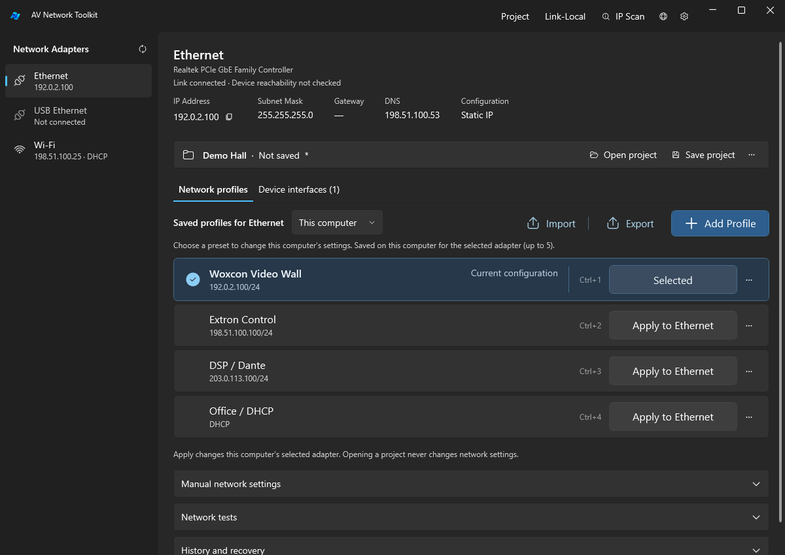
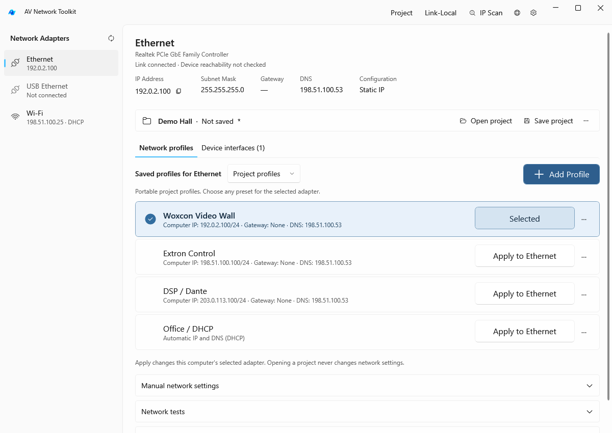
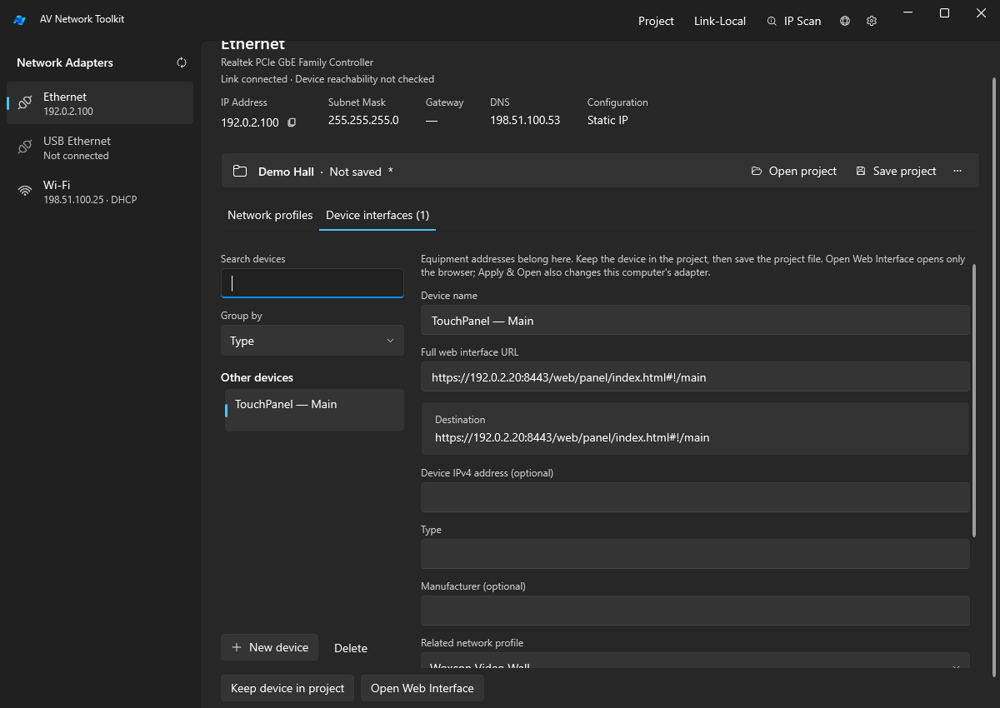
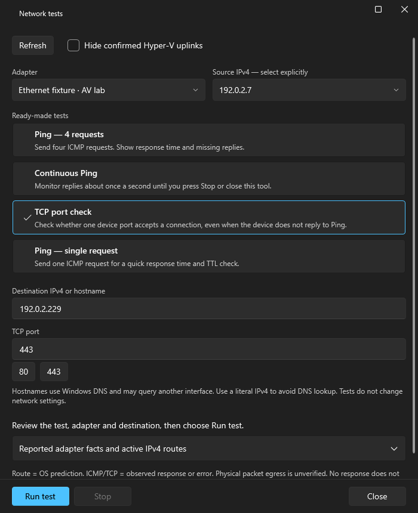
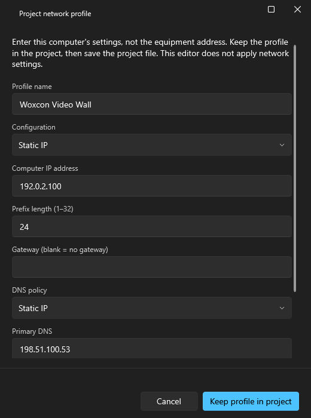
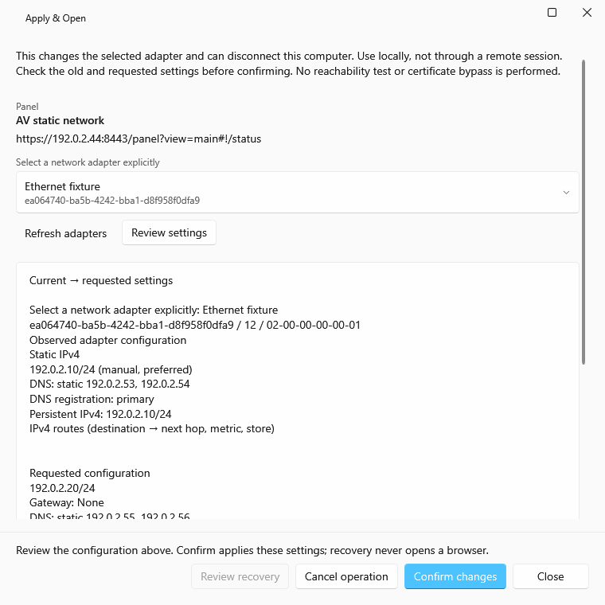
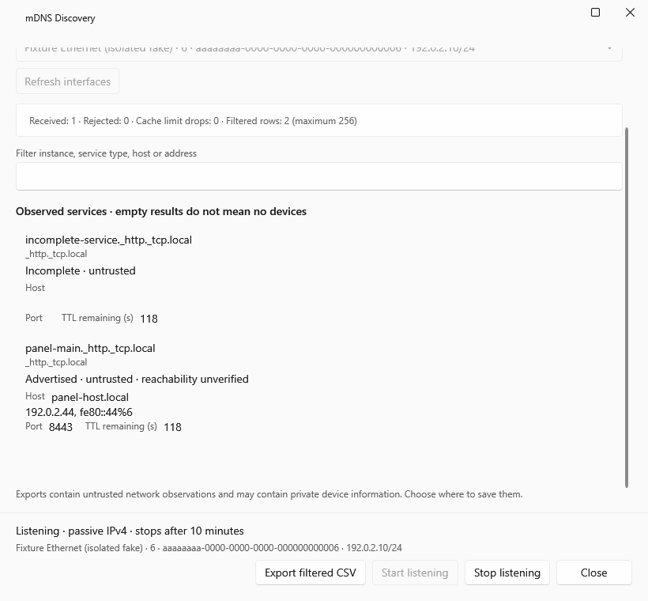

# AV Network Toolkit

<div align="center">
  
  <br><br>
  <a href="https://github.com/Elguajo/AV-Network-Toolkit/actions/workflows/build.yml">
    
  </a>
  <a href="LICENSE">
    
  </a>
</div>

<br>

<div>
Windows network profiles and project-scoped device web interfaces for AV field work. Select an adapter, review the computer's current settings, deliberately apply a saved profile, then open the equipment interface when needed.

**1.1.3 Preview:** includes audit safety/storage fixes, consistent Light/Dark windows, corrected tray placement, a cleaner adapter list with Show all and self-contained .NET 10 packages. Automated checks do not replace isolated hardware acceptance; read the [release limitations](docs/releases/v1.1.3.md#known-limitations) before changing a working network.

**Since 1.1.1:** local Apply/Revert uses the verified typed workflow, file failures preserve saved data, and development targets .NET 10 LTS. [Compatibility limits and evidence](docs/testing/AUDIT_FIXES_REVIEW.md). The earlier v1.1.1 downloads remain unchanged on .NET 8. Native/phase acceptance and the known diagnostic-stop smoke issue remain open.
</div>



*Select an adapter, review its current configuration and choose a saved profile. [Explore the screenshots below](#screenshots).*

## Download and start

Get both formats from [Releases](https://github.com/Elguajo/AV-Network-Toolkit/releases):

| Package | Use |
|---|---|
| `AVNetworkToolkit-1.1.3-win-x64-setup.exe` | Primary installer: Program Files, Start menu shortcut and uninstaller. Installation requests administrator permission. |
| `AVNetworkToolkit-1.1.3-win-x64-portable.zip` | Additional option: extract the entire ZIP into a dedicated folder, then run `NetworkProfileManager.exe`. Keep all five WPF DLLs beside it. |

Both include .NET 10: users do not need to install .NET or the SDK separately. Target is x64 Windows under Microsoft's [.NET 10 OS matrix](https://github.com/dotnet/core/blob/main/release-notes/10.0/supported-os.md): Windows 11 and listed Windows 10 LTSC/IoT/Enterprise versions; ordinary Windows 10 22H2 is not listed. Hosted package verification uses Windows Server 2022 with global .NET discovery disabled and a negative control, not a complete Windows-client/hardware certification. Binaries are currently unsigned; Windows may show an unknown-publisher warning. Download only artifacts whose source and SHA-256 you trust. Check `SHA256SUMS.txt` with PowerShell `Get-FileHash`.

The application runs unelevated by default. Applying network changes is a separate deliberate operation that requests administrator rights through UAC. Opening a project or selecting a device does not apply settings.

## Main workflows

- **Computer profiles:** retain named per-adapter static/DHCP profiles, IP/mask/gateway/primary+secondary DNS, five local slots, JSON import/export and existing scanner/history/tray tools.
- **Project profiles:** independent versioned project JSON, explicit Open/Save/Save As, multiple profiles and adapter hints. Project and local stores remain separate; hints do not silently select a NIC on another computer.
- **Device interfaces:** save/search/group device entries and exact HTTP/HTTPS deep links, associate a profile, then choose Open or Apply & Open. Unsafe schemes and URL credentials are rejected. Password fields are not implemented in v1.
- **Apply & Open / standalone project Apply:** target the selected adapter, review old/requested values, confirm, verify observed configuration and optionally open the device. Complex or unknown affected state is blocked. Recovery uses an explicit new review/confirmation; it is best effort, not atomic rollback.
- **Network tests:** choose four-request Ping, Continuous Ping, single Ping or one-port TCP check. Adapter/source and destination are explicit. Run/Stop controls and a separate test window are available. Route prediction/source binding do not prove actual physical egress; a TCP connection does not validate HTTP/TLS.
- **AV tools:** manual Link-Local with DAD-aware verification/recovery, passive selected-interface IPv4 mDNS listener, adapter/Hyper-V facts and optional diagnostic uplink filtering. Every live test/listener is explicit.

## Screenshots

These are actual WPF views rendered from the current source with the new logo and invented demonstration data. Network, browser and elevation operations are replaced by test doubles; the images show the interface, not live-network acceptance. Click an image to view it at full size. [Capture source and verification](docs/screenshots/readme/README.md).

### Project profiles · light theme

Keep project profiles separate from this computer's local profiles. Each Apply action names the selected adapter; the matching current configuration is marked Selected.



### Device web interfaces

Keep equipment links in the project, search the directory and preserve full URLs, including ports, paths and fragments. Open Web Interface and Apply & Open are separate actions.



### Network tests

Choose four-request Ping, Continuous Ping, single Ping or a TCP port check, then explicitly select the adapter, source IPv4 and destination. The separate window includes descriptions and Run/Stop controls.



<details>
<summary>More screenshots: profile editor, Apply & Open and mDNS discovery</summary>

### Profile editor

Edit the computer's static IP, prefix, gateway and DNS policy in a separate dialog. Keeping a profile in the project does not apply it to Windows.



### Apply & Open review

Review the selected adapter's observed and requested settings before deliberately confirming a change.



### Passive mDNS discovery

Select an interface and start listening explicitly. Inspect advertised services, addresses, ports and TTL, then optionally export filtered CSV results.



</details>

## Data and updates

Profiles, history, scanner and theme/language settings currently remain under:

```text
%LOCALAPPDATA%\NetworkProfileManager\data\
```

Project JSON stays in the folder you explicitly choose. New-flow private recovery journals are under `%LOCALAPPDATA%\NetworkProfileManager\apply-recovery` and may contain private network configuration. Back up these folders and your projects before updating.

Exit the application through its tray Exit action before replacing/installing files. The installer does not force-close a busy app or remove user data on uninstall. Portable updates replace application files only; the ZIP does not make settings USB-local. There is no automatic updater. A future move to `%USERPROFILE%\.av-network-toolkit` is approved but **not implemented in this release**.

In current source, local profile/history saves use atomic replacement with unique backups. Corrupt files and backups are preserved; repair/restore them before retrying. A save conflict requires refresh. Add/Edit keeps the draft open if saving fails. Private journals and backups can grow; retain them securely and manage retention manually.

New local history points to the exact recovery journal, including the supported original DNS policy. Older history has an explicit incomplete-restore warning: recorded address settings or DHCP policy only, never complete restoration of unknown DNS/routes/leases. Missing journals block full recovery. Recovery lists preserve damaged files, show healthy entries and offer pages beyond 1000 files.

## Verification and limits

The [packaging report](docs/testing/PACKAGING_REVIEW.md), [test matrix](docs/testing/TEST_MATRIX.md), [JSON regression evidence](docs/testing/JSON_VALIDATION_REVIEW.md) and [release notes](docs/releases/v1.1.3.md) distinguish unit/fake, WPF, packaged-host and native evidence. GitHub CI runs isolated unit tests, schema/planning checks and package installation/runtime-discovery checks on disposable Windows runners.

Real NIC/DAD/UAC/IPC/multicast/route/ICMP/TCP behavior, actual packet egress, clean Windows-client deployment, cross-version installer upgrades and manual accessibility remain separate acceptance work. No temporary DHCP server or device-password storage is shipped. Current source uses the same conservative contract for local/manual/tray and project Apply: static automatic DNS, /31–/32, initial DHCP without a usable lease/APIPA and complex/managed settings are blocked. Static empty DNS means unchanged; empty gateway explicitly removes the supported default gateway after review. See the [compatibility matrix](docs/spec/AUDIT_FIXES_CONTRACT.md).

## Development

Use the .NET 10 SDK selected by `global.json`; runtime is bundled only in published packages, not ordinary build output.

For current .NET 10 builds, follow Microsoft's [supported OS matrix](https://github.com/dotnet/core/blob/main/release-notes/10.0/supported-os.md). The existing Windows 10 lab does not certify .NET 10 startup or native behavior.

```powershell
git clone https://github.com/Elguajo/AV-Network-Toolkit.git
cd AV-Network-Toolkit
dotnet build AVNetworkToolkit.sln -c Release
dotnet test test/NetworkProfileManager.Tests.csproj -c Release --no-build
```

Build both packages from a clean checkout with PowerShell 7:

```powershell
./scripts/build_packages.ps1
```

The script downloads and verifies pinned Inno Setup 6.7.4 build tools, publishes a self-contained win-x64 payload, executes the non-network package self-test and creates installer/ZIP plus a source/hash manifest under a fresh `out/packages` directory. A repeat build needs a fresh output directory. Native DLLs stay beside the executable instead of being extracted to a user-writable temporary location. See [packaging contract](docs/spec/PACKAGING_CONTRACT.md).

`app/` contains the .NET 10 WPF/MVVM application, `test/` its isolated xUnit suite, `schemas/` and `examples/` the project format, `scripts/` build/verification tools and `packaging/` installer configuration. Internal namespace/executable identities remain `NetworkProfileManager` for compatibility. [Contributing](CONTRIBUTING.md), [security reporting](SECURITY.md), [roadmap](ROADMAP.md).

## License and provenance

Forked from [Network Profile Manager](https://github.com/rmzncakir/network-profile-changer). [MIT license](LICENSE), copyright 2026 rmzncakir, retained unchanged; [third-party notices](docs/legal/THIRD_PARTY_NOTICES.md). The new logo was supplied by the owner. AV Network Toolbag is a behavior reference only; no source code, artwork or UX assets from that unlicensed repository are copied into this product.
