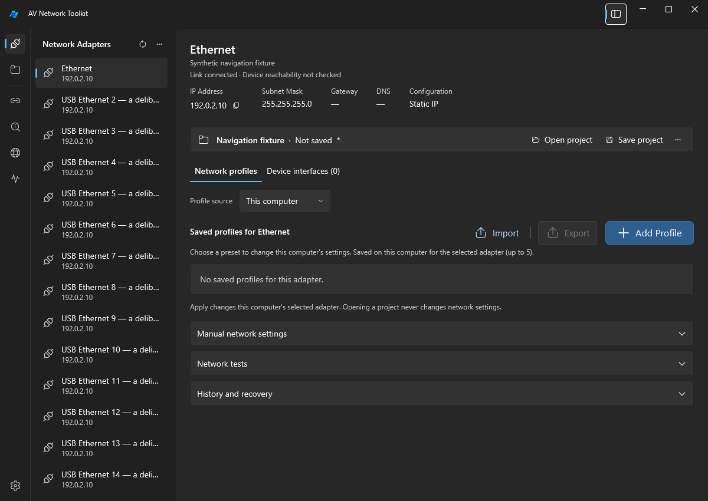

> **Release status: Preview.** Physical networking/recovery, actual 150%/200% or mixed-monitor DPI, touch and Narrator acceptance remain incomplete.

> **Important update — corrected packages:** 1.1.5 was re-uploaded with the Teredo notification fix. If you downloaded 1.1.5 before the correction, **download it again**, exit the old copy through the tray and replace/update the package. The displayed version is still **1.1.5**; the manifest and executable informational version identify corrected source **9e06c48**. Teredo/IPv6 and Windows network settings are not disabled or changed.

Move between profiles, equipment links and diagnostics from a persistent tool rail, and return to the window/sidebar layout you saved. Changes are relative to **1.1.3**, the previous published release; 1.1.4 was a local-only test candidate.

## ✨ Highlights

### Reach tools from one place

The icon rail provides adapters, projects, Link-Local, IP Scanner, mDNS and Network tests, with Settings at the bottom. Existing separate tool windows remain available.

*Actual isolated WPF component capture with invented data; not a live-network result.*

### Give your current work more room

Show/hide the adapter sidebar with its button or **Ctrl+B**. Drag its divider or focus it and use arrow keys to resize. Adapter selection, drafts, profile source, scroll position and running diagnostics survive visibility changes.

The app remembers normal window size/position, maximized state, sidebar width/collapse and maximized tray restoration. A disconnected monitor falls back to a connected work area; minimized dimensions do not replace normal restore geometry.

### Know which tools are active

Rail indicators reflect actual inline/separate-window tests and mDNS listening, with accessible status text. Overlapping runs and cancellation draining keep the indicator active until the last operation finishes. Navigation alone starts no traffic.

## Fixes & improvements

- **Notifications:** repeated Teredo/tunnel state changes no longer produce Connection established / Connection lost notifications. Ethernet, Wi-Fi and ordinary virtual Ethernet notifications remain available. Actual native Teredo/tray acceptance is still pending.
- **Profile context:** a labelled Profile source row sits above saved profiles; **Show all adapters** is in the adapter header's More menu.
- **Interaction:** sidebar divider/scrollbar reveal on hover/focus; the divider shows a resize cursor.
- **Display:** per-monitor DPI awareness and actual-monitor maximize bounds; physical validation covered 100% only.
- **Test reliability:** the diagnostic hide/cancel race was resolved as a smoke-test synchronization defect, with deterministic Hide/Show and late-response coverage. Product cancellation behavior was preserved, not fixed by that test change.

## 📦 Download

| Package | Recommended for |
|---|---|
| [Windows x64 installer](https://github.com/Elguajo/AV-Network-Toolkit/releases/download/v1.1.5/AVNetworkToolkit-1.1.5-win-x64-setup.exe) | Regular installation: Program Files, Start menu shortcut and uninstaller. Setup requests administrator permission. |
| [Windows x64 portable ZIP](https://github.com/Elguajo/AV-Network-Toolkit/releases/download/v1.1.5/AVNetworkToolkit-1.1.5-win-x64-portable.zip) | Field use: extract the entire archive and run `NetworkProfileManager.exe` with all accompanying files, including the native WPF DLLs. |

**Requirements:** Windows x64; both packages include the same application payload and **.NET 10** runtime. No separate runtime or SDK installation is required. Follow Microsoft's [.NET 10 supported OS matrix](https://github.com/dotnet/core/blob/main/release-notes/10.0/supported-os.md#windows). Ordinary Windows 10 22H2 is not listed. Bundling the runtime does not extend OS support.

**Security:** binaries are unsigned. Compare the download's SHA-256 with [SHA256SUMS.txt](https://github.com/Elguajo/AV-Network-Toolkit/releases/download/v1.1.5/SHA256SUMS.txt); [package-manifest.json](https://github.com/Elguajo/AV-Network-Toolkit/releases/download/v1.1.5/package-manifest.json) records the package hashes and exact source.

## 🔄 Updating

1. Back up local profiles, settings, history, private recovery journals and project JSON files.
2. Use **Exit** in the tray menu before installing or replacing files. Closing the main window can leave the application running.
3. Run the installer, or replace the portable application with the complete extracted package.

**Your data:** profiles/settings/history remain in `%LOCALAPPDATA%\NetworkProfileManager\data`, recovery journals in `%LOCALAPPDATA%\NetworkProfileManager\apply-recovery`, and project JSON where you save it. Uninstall retains user data. Installer and ZIP share these per-user locations; portable does not mean USB-local settings. No home-folder migration is included. Keep backups and journals securely and manage their retention manually.

These steps also apply to the original 1.1.5 downloads. Project/profile formats remain unchanged. New `window_layout.json` holds only private UI preferences in the existing data folder; older releases ignore it. Invalid/newer-format preferences are preserved, and noncritical save failure may retain the previous layout without blocking exit.

## Known limitations

- **Network operations:** explicitly select the intended adapter and review current/requested values. Complex/unknown/managed settings, multiple IPv4 addresses, static automatic DNS, /31–/32 and initial no-lease/APIPA states remain blocked by the shared local/project Apply contract; profiles remain editable. Empty DNS in local static input leaves DNS unchanged, while an empty gateway removes the supported default gateway after review. Project static-DNS profiles require valid explicit DNS.
- **Recovery:** newer history requires its exact valid, matching recovery journal; missing/mismatched journals block full recovery. Older history only offers its warned address/DHCP-policy restore. Recovery is separately confirmed, non-atomic and can fail. DHCP recovery restores policy, not the previous lease. Keep independent recovery.
- **Validation:** Real NIC/UAC/IPC/DAD, DNS/route recovery, ICMP/TCP/multicast, physical egress and driver/topology acceptance remain unverified. Source binding and route prediction do not prove actual physical egress; TCP acceptance does not validate HTTP/TLS. Hosted Windows Server package checks do not certify a pristine Windows client or historical cross-version upgrades. Actual Teredo/tray delivery, higher/mixed-monitor DPI, touch and Narrator remain pending; layout simulations are not native-display certification. The original navigation capture evidence does not validate the corrected package's native behavior.
- **Scope:** No temporary DHCP server, device-password storage, automatic device login, TLS bypass, automatic updater or USB-local data mode is shipped. Opening a project or selecting a device never applies network settings. Historical network-validation owner acceptance remains pending; resolving a test race does not complete those checks.

See the [supported-state contract](https://github.com/Elguajo/AV-Network-Toolkit/blob/v1.1.5/docs/spec/AUDIT_FIXES_CONTRACT.md) and [layout/DPI limits](https://github.com/Elguajo/AV-Network-Toolkit/blob/v1.1.5/docs/testing/NAVIGATION_FOLLOWUP_REVIEW.md).

## Verification & technical details

Corrected source **`9e06c48`** passed local/hosted Release builds with **0 warnings/errors**, **744 unit tests**, **12 tooling tests**, repeated synthetic tunnel transitions and preserved Ethernet/Wi-Fi notification checks. Bundled-runtime/startup/install/reinstall/uninstall/retention gates and independent public-download/source/checksum checks passed in [workflow 41339102871](https://github.com/Elguajo/AV-Network-Toolkit/actions/runs/41339102871). Original `2b78f67` navigation/UI evidence remains historical; it is not relabelled as a corrected-source run.

- [Full changelog](https://github.com/Elguajo/AV-Network-Toolkit/blob/v1.1.5/CHANGELOG.md)
- [Compare 1.1.3 → 1.1.5](https://github.com/Elguajo/AV-Network-Toolkit/compare/v1.1.3...v1.1.5)
- [Test evidence](https://github.com/Elguajo/AV-Network-Toolkit/blob/314bf64/docs/testing/RELEASE_1.1.5_REUPLOAD_REVIEW.md)

Public Issues and Discussions are currently disabled for this repository; a general bug-reporting destination is not available.

## License & credits

[MIT license](https://github.com/Elguajo/AV-Network-Toolkit/blob/v1.1.5/LICENSE), based on [Network Profile Manager](https://github.com/rmzncakir/network-profile-changer), copyright 2026 rmzncakir, with upstream attribution and [third-party notices](https://github.com/Elguajo/AV-Network-Toolkit/blob/v1.1.5/docs/legal/THIRD_PARTY_NOTICES.md) retained. No source, artwork or resources from the unlicensed AV Network Toolbag reference are included.
