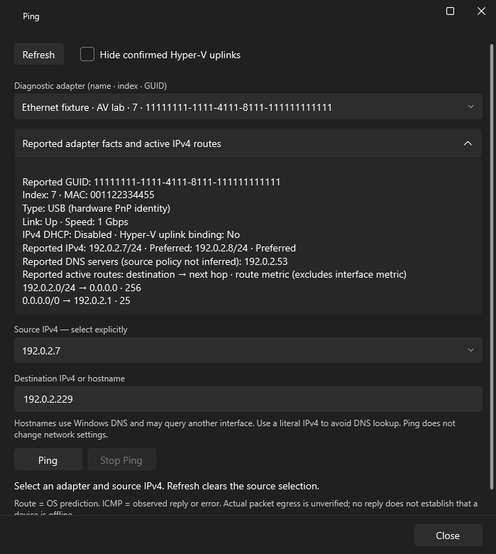
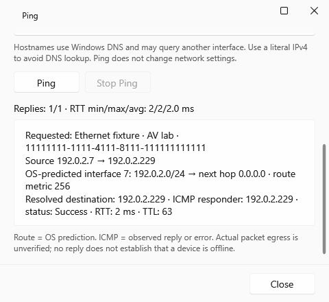

# Phase 07 — Ethernet/Hyper-V diagnostics and explicit-source Ping

2026-11-01, Asia/Tashkent. Fork https://github.com/Elguajo/AV-Network-Toolkit, direct `main`, clean bootstrap `db143aba6e4405da57acf2a85f661f3b579c279d`. ADR-034 authorizes 07-T01–07-T04. Implementation anchor resolves with `git log -1 --format=%H -- app/Services/DiagnosticPingService.cs`; the following documentation handoff pins the actual SHA. No branch, worktree, push, release or phase acceptance.

## Outcome and scope

Phase 07 **AWAITING_REVIEW**, all four tasks **EVIDENCE_RECORDED**, acceptance boxes stay open. [Implementation/support contract](../spec/PHASE07_IMPLEMENTATION_CONTRACT.md). The owner started this phase without retroactively accepting earlier native/manual work.

| Task | Implemented behavior and evidence | Acceptance boundary |
|---|---|---|
| 07-T01 | Fixed read-only Windows snapshot: GUID/index/MAC/name, physical Ethernet/Wi-Fi, hardware PnP USB, virtual/Hyper-V driver evidence, explicit unknown; duplicate identities/indexes rejected | 15 fake query variants, including misleading name, unknown/ambiguous bindings, unplugged adapter, identity change and unavailable query; real hardware mapping NOT RUN |
| 07-T02 / ADR-016 | Shared inline/window MVVM panel: selected adapter/source IPv4, all IPv4/prefix/states, DHCP, DNS, link/speed, active routes/default gateway; source-specific native ICMP after OS route validation; request/prediction/observed reply clearly separated; RTT/TTL and 4-echo min/max/avg summary retained | Literal avoids DNS, hostname uses OS DNS; no send on open/refresh/selection; no cross-interface fallback. Source-only native call and predicted route never certify physical egress |
| 07-T03 | Default-off `HideHyperVUplinks` preference in the existing flat settings dictionary; hide only uniquely evidenced physical `vms_pp` uplinks in diagnostic selectors, unknown stays visible; clear hidden selection | Preference restart/other-key/no-startup-rewrite test uses temp data only. Legacy main/tray enumeration remains available. Existing best-effort settings writer/retention limitations unchanged |
| 07-T04 | 48 added unit cases plus fake query/script and actual WPF-control verification; bounded query output/timeout, 256-adapter and malformed/ambiguous snapshot checks, no real NIC/probe in tests | Native performance, driver/process failure behavior and topology acceptance remain UNVERIFIED; a bounded fixture is not a hardware benchmark |

No project schema, store migration, credential fields, apply support expansion, DHCP server or general shell. Scanner, legacy profile import/export/five-slot storage, named profiles, settings paths, history/revert, tray, UAC, IPv6 configuration and MIT notices remain unchanged. Intentional Ping behavior refinement: both forms require an explicit diagnostic adapter/source and deliberate Ping; opening the separate window reads local facts and does not auto-send. New source-bound flow is IPv4; the existing destination-only NetworkService method is untouched and is not used by these two controls.

## Changed paths

- `app/Models/AdapterDiagnostics.cs`: immutable local snapshots, request/prediction/echo/result identities and presentation.
- `app/Services/WindowsAdapterDiagnostics.cs`, `DiagnosticPingService.cs`, `WindowsDiagnosticPingPlatform.cs`: bounded fixed query, fakeable resolver/identity/route/ICMP boundaries, native route and source-specific echo with handle/buffer cleanup.
- `app/ViewModels/AdapterDiagnosticsViewModel.cs`, `MainViewModel.cs`: shared independent operation owners, source/selection/busy/refresh/cancellation/close rules and main integration.
- `app/Views/AdapterDiagnosticsPanel.xaml[.cs]`, `PingWindow.xaml[.cs]`, `app/MainWindow.xaml[.cs]`, `app/Strings/En.xaml`: existing Fluent/Mica/Card/FooterBar/resources; localized additions, scrollable facts/results and fixed window Close. Main navigation never implicitly selects the diagnostic source/adapter. Only an already explicitly chosen diagnostic GUID may carry into the separate window; its source is reset.
- `test/AdapterDiagnosticsTests.cs`, `DiagnosticPingTests.cs`, `scripts/validate_adapter_diagnostics.ps1`, `scripts/ProjectUiSmoke/DiagnosticsSmoke.cs`, `Program.cs`: fake-boundary unit/script/component regression evidence.
- `PROJECT_CONTEXT.md`, `ROADMAP.md`, `CODEX_START.md`, `STATUS.md`, `TASKS.md`, `machine/plan.json`, `phases/07-adapter-hyperv-diagnostics.md`, `decisions/DECISION_LOG.md`, `DESIGN.md`, support contract and test matrix/review: authorization, state and evidence. Existing task IDs retained, no acceptance fabricated.

## Exact automated checks

Windows, PowerShell 7 and .NET SDK 8.0.427. From repository root, `$sdk = "$env:LOCALAPPDATA/AVNetworkToolkit.BuildTools/dotnet/dotnet.exe"`; `$py = "$env:LOCALAPPDATA/AVNetworkToolkit.BuildTools/python/Scripts/python.exe"`.

| Exact command/check | Observed result |
|---|---|
| `& $sdk build AVNetworkToolkit.sln --configuration Release --no-restore -p:OutputPath=bin/Phase07Final/` | PASS, 0 warnings/errors |
| `& $sdk test test/NetworkProfileManager.Tests.csproj --configuration Release --no-restore -p:OutputPath=bin/Phase07Final/ --filter 'FullyQualifiedName~AdapterDiagnosticsTests\|FullyQualifiedName~DiagnosticPingTests\|FullyQualifiedName~DiagnosticPreferenceTests\|FullyQualifiedName~StringResourceTests' --logger 'trx;LogFileName=phase07-focused-reviewed.trx' --results-directory TestResults/Phase07` | PASS 51, 0 failed/skipped (48 new + 3 unchanged resources). In the actual shell the filter pipes are literal `|`, without Markdown escapes |
| `& $sdk test test/NetworkProfileManager.Tests.csproj --configuration Release --no-build -p:OutputPath=bin/Phase07Final/ --logger 'trx;LogFileName=phase07-final-reviewed.trx' --results-directory TestResults/Phase07` | Final **PASS 624, 0 failed, 0 skipped**; prior full intermediate 621 PASS before three additional cases. Does not resolve OPEN JSON instability |
| `& ./scripts/validate_adapter_diagnostics.ps1` | PASS parse/command allowlist + 15 fake OS fixtures, no real queries/probes |
| `& "$env:WINDIR/System32/WindowsPowerShell/v1.0/powershell.exe" -NoProfile -NonInteractive -File ./scripts/validate_adapter_diagnostics.ps1` | PASS the same 15 fixtures in Windows PowerShell 5.1; no real queries/probes |
| `& ./scripts/validate_apply_observation.ps1` | PASS 11 existing fake apply-observer cases; no real OS queries |
| `& $sdk build scripts/ProjectUiSmoke/ProjectUiSmoke.csproj --configuration Release --no-restore -p:OutputPath=bin/Phase07Final/` | PASS, 0 warnings/errors |
| `& $sdk scripts/ProjectUiSmoke/bin/Phase07Final/ProjectUiSmoke.dll TestResults/Phase07UiFinal --phase07` | PASS **32** focused WPF captures/0 binding errors; Light/Dark window 700×780 / 480×440 and main 1200×850 / 760×520 |
| `& $sdk scripts/ProjectUiSmoke/bin/Phase07/ProjectUiSmoke.dll TestResults/Phase07RegressionUi` | PASS **128** existing project/device/apply/link-local/mDNS/main workspace captures/0 binding errors. Run earlier during this change; subsequent edits to TTL/fact copy/diagnostic source choice were covered by final focused rendering/unit tests, not a repeated general capture batch |
| `& $py -B scripts/validate_plan.py`; `& $py -B scripts/test_validate_plan.py`; `git diff --check` | PASS schema/formats/planning/links and 10 validator regressions; no weakened gates |
| `git diff --name-only db143ab -- schemas examples app/Services/ProjectJson.cs app/Services/ProjectStore.cs app/Services/NetworkService.cs app/Services/ProfileRepository.cs app/Services/HistoryRepository.cs app/Services/ProjectApplyCoordinator.cs app/Services/ProjectApplyWorker.cs app/Services/WindowsProjectApplyObservation.cs LICENSE .github/workflows` | Empty protected-path diff; source comparison only, not live legacy certification |

Ignored local evidence: `TestResults/Phase07/*.trx`, `TestResults/Phase07UiFinal/*.png`, `TestResults/Phase07RegressionUi/*.png`. Representative final captures are retained below as repository evidence; all use documentation-range fixtures.

Initial corrections are part of this change, not hidden passes: the first test build lacked `System.IO`; the first render-harness build referenced a helper that was local to another scenario; both were corrected. WPF controls then exposed missing command requery after explicit source/target input; corrected and rerendered. Initial captures were taken before Expander animation settled and XAML normalized fact line breaks; added bounded animation settling to the harness and preserved resource whitespace. Windows PowerShell 5.1 initially exposed a **fixture assertion** single-object `.Count` difference; normalized the test result and used explicit array counts. Production script was unchanged for that correction. A temporary Python write used the host's ANSI default for several existing UTF-8 files; diff review caught the encoding changes and restored the original text before verification/commit.

Final primary-source review caught the documented initialized-interface requirement on `GetBestRoute2`; the draft's zero-index route lookup was corrected before commit. `GetBestRoute(destination, source)` now obtains the OS-selected interface first, and `GetBestRoute2` uses that observed index for details. Both native row layouts are fixture-checked; full 624-unit and focused UI/script gates were rerun after correction. Actual native execution remains NOT RUN.

## Focused reviews and visual evidence

| ID / kind | Status | Source / decision |
|---|---|---|
| P07-SPEC / contract | passed within fixture boundary | Task mapping above; stable scope/IDs, strict JSON and protected paths retained |
| P07-CODE / code review | passed after corrections | Final changed data/control flows: immutable request/result, no alias command interpolation, no destination-only fallback, bounded output/parse, handle/buffer/process/reader cleanup; no remaining actionable defect found in inspected scope |
| P07-CONC / concurrency | passed within fake boundary | Deterministic in-flight selection/reentry, removal during resolution, route/NIC change after echo, Stop and disposal tests. Inputs frozen during a run; close cancels future work and suppresses late UI results. Native synchronous calls retain limits below |
| P07-UI / visual QA | passed within component boundary | Actual WPF controls, named selectors/target, command enablement, busy/Stop, success/blocked result, unavailable refresh, minimum scrolling, fixed Close, keyboard traversal; 32 focused renders. Existing 128 capture regression also passed. Matches DESIGN.md resources and localized addition; no pixel-fidelity claim |
| P07-A11Y / accessibility | partial; native unavailable | Actual focus adapter→facts and named inputs/command states/Close bounds checked, status live property present. Manual AT/high contrast/system scaling/native Mica/hover/press/full keyboard walkthrough NOT RUN |
| P07-REG / automated regression | passed for recorded run | 624 full tests; 15 new and 11 existing fake query cases; resource and planning gates unchanged. OPEN UX-R01/P05-R01 is not closed |
| P07-GATE / release check | **NO-SHIP** | Owner/native acceptance and OPEN JSON blocker remain; no release or Phase 08 authorization |

## Risks, deviations and next step

Native local PowerShell/NIC/Hyper-V/USB classification, ICMP/route/TTL ABI and actual packet egress, driver/privilege/policy/compartment behavior, DNS path, real unplug/route races, elevated apply/recovery, browser, multicast and DHCP are **NOT RUN / UNVERIFIED**. Tests use fake boundaries and do not certify OS behavior. Synchronous native NIC enumeration/route reads are not interruptible and can outlast the 10 s cancellation budget; an already-entered echo can finish within its 2 s timeout. Source selection plus route checks cannot eliminate check-to-send races or prove egress. A `vms_pp` binding is reported evidence, not a full Hyper-V topology guarantee. Optional PnP/binding failure retains unknown rather than inferring from names.

Bounded integration choices/deviations: filter is scoped to diagnostic selectors so existing main/tray switching stays available; source and adapter are explicit rather than inheriting a legacy auto-first selection; no schema or parallel settings store. DNS-source policy is intentionally not inferred from server addresses. No phase task was dropped; native acceptance stays pending. Existing settings writer best-effort behavior and OPEN UX-R01/P05-R01 are not repaired in this phase.

Safe next action: owner reviews this diff, contract and captures, then separately scopes deterministic JSON investigation and isolated Windows/native acceptance. Proposed next development phase is **08 — temporary DHCP server**, requiring a new owner decision and written binding/conflict/firewall/cleanup safety design **before implementation**. Do not start it, publish, or declare any phase complete from these automated results.
